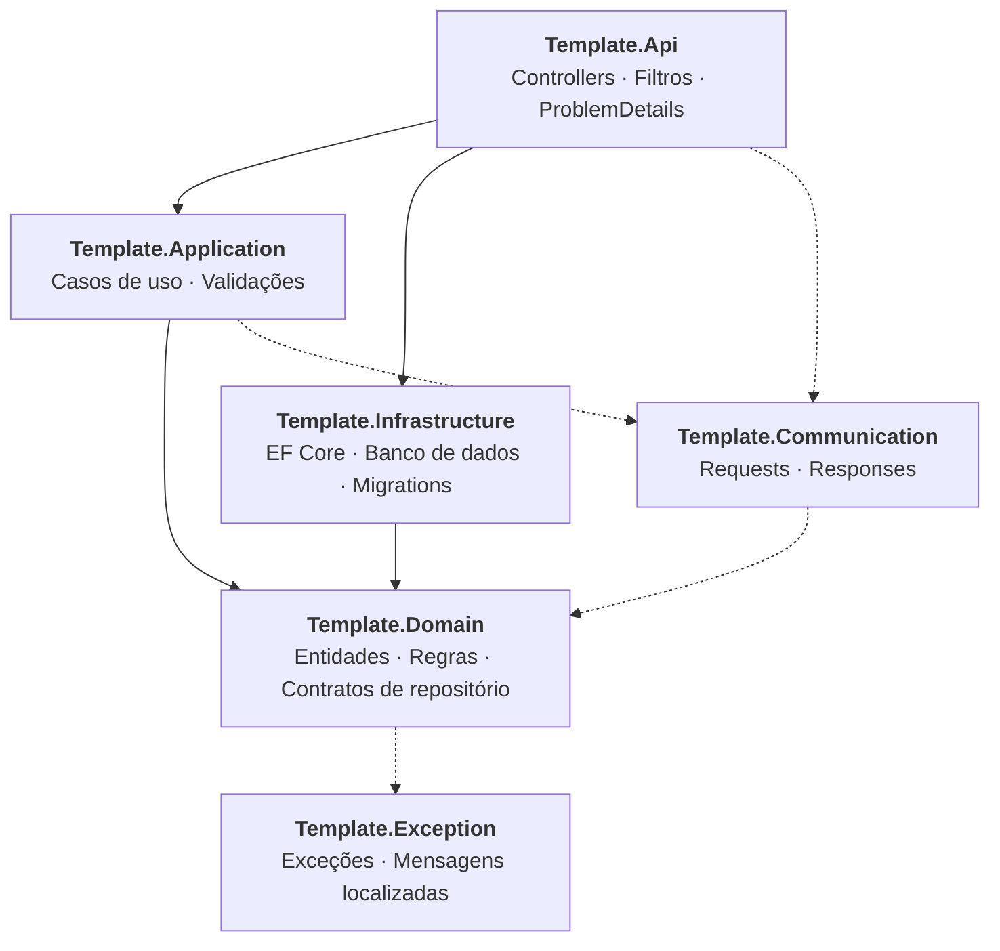

<div align="center">

# 🚀 Template

**API REST em .NET 10 com Clean Architecture e PostgreSQL.**

[](https://dotnet.microsoft.com/)
[](https://learn.microsoft.com/dotnet/csharp/)
[](https://www.postgresql.org/)
[](https://docs.docker.com/compose/)
<!--#if (observability) -->
[](https://opentelemetry.io/)
<!--#endif -->
[](LICENSE)

</div>

---

## 📖 Sobre

<!--#if (auth) -->
O **Template** é uma API backend gerada a partir do template `cleanapi`. Ela já vem com cadastro de usuários, login com JWT e toda a base de infraestrutura pronta; o domínio de negócio é construído a partir daqui.
<!--#else -->
O **Template** é uma API backend gerada a partir do template `cleanapi`. Ela já vem com toda a base de infraestrutura pronta; o domínio de negócio é construído a partir daqui.
<!--#endif -->

---

## ✨ Funcionalidades

<!--#if (auth) -->
### 👤 Usuários e autenticação
- Cadastro de usuário com validação de nome, e-mail e senha (mínimo de 8 caracteres)
- Senhas armazenadas com **Argon2**
- Login que devolve um **JWT** (HMAC-SHA256) com expiração configurável
- Todos os endpoints exigem token por padrão (*fallback policy*); os públicos usam `[AllowAnonymous]`
- Perfil do usuário autenticado em `GET /api/usuarios/perfil`

<!--#endif -->
### 🧱 Base pronta
- Tratamento de erros único em **ProblemDetails**, com mensagens localizadas (pt-BR e en)
- Paginação padronizada (`RequestPaginationJson` / `ResponsePagedJson`)
- Concorrência otimista com a coluna de sistema `xmin` do PostgreSQL
- Tempo sempre lido de `TimeProvider`, substituído por `FakeTimeProvider` nos testes
- Migrations aplicadas automaticamente fora de produção
- Health check em `/health`, incluindo a conectividade com o banco

---

## 🏛️ Arquitetura

A solução segue os princípios da **Clean Architecture**: o domínio fica no centro, sem depender de frameworks, e as camadas externas dependem das internas.



```
Template
├── src
│   ├── Backend
│   │   ├── Template.Api              # Camada HTTP: controllers, filtros, ProblemDetails
│   │   ├── Template.Application      # Um caso de uso por operação
│   │   ├── Template.Domain           # Entidades ricas, validadores e interfaces de repositório
│   │   └── Template.Infrastructure   # DbContext, mapeamentos, repositórios, Unit of Work, migrations
│   └── Shared
│       ├── Template.Communication    # Contratos de entrada e saída da API
│       └── Template.Exception        # Hierarquia de exceções e mensagens (.resx)
└── tests
    └── src
        ├── CommonTestUtilities             # Builders, mocks e o banco de testes (Testcontainers)
        ├── Template.Domain.Tests
        ├── Template.Application.Tests
        ├── Template.Infrastructure.Tests
        └── Template.Api.IntegrationTests
```

### Decisões de design

| Tema | Abordagem |
| --- | --- |
| **Domínio rico** | Entidades com setters privados, criadas por métodos de fábrica que validam as próprias invariantes. |
| **Casos de uso** | Cada operação é uma classe com interface própria, o que mantém responsabilidades pequenas e testáveis isoladamente. |
| **Repositórios segregados** | Interfaces separadas para leitura (`ReadOnly`, sem rastreamento), escrita (`WriteOnly`) e alteração (`UpdateOnly`). |
| **Unit of Work** | A persistência é confirmada em um único ponto, ao final de cada caso de uso; conflitos de concorrência retornam `409 Conflict`. |
| **Erros padronizados** | Todas as respostas de erro seguem o **ProblemDetails (RFC 9457)**, com a lista `errors` e o `traceId` da requisição. |
| **Mensagens centralizadas** | Textos de erro em arquivo de recursos (`.resx`), com localização por `Accept-Language` já configurada no pipeline. |
| **Cancelamento** | O `CancellationToken` é propagado dos controllers até o banco; requisições abortadas pelo cliente retornam `499`. |
| **Higiene do código** | Analisadores do .NET ativos no build, `TreatWarningsAsErrors` e versões de pacotes centralizadas (`Directory.Packages.props`). |

---

## 🧰 Tecnologias

| Categoria | Ferramentas |
| --- | --- |
| **Plataforma** | .NET 10, ASP.NET Core, C# |
| **Persistência** | Entity Framework Core 10, PostgreSQL 17 (Npgsql) |
| **Documentação da API** | OpenAPI nativo + Swagger UI |
<!--#if (observability) -->
| **Observabilidade** | OpenTelemetry (logs, traces e métricas), exportação OTLP, .NET Aspire Dashboard, health checks |
<!--#endif -->
| **Testes** | xUnit, Shouldly, Moq, Bogus, Testcontainers, `WebApplicationFactory`, Coverlet |
| **Infraestrutura** | Docker (build multi-stage, usuário não-root), Docker Compose |

---

## 🚀 Como executar

### Pré-requisitos

- [Docker](https://www.docker.com/) e Docker Compose
- [.NET SDK 10](https://dotnet.microsoft.com/download) (apenas para executar fora do Docker ou rodar os testes)

### Opção 1 — Docker Compose (recomendado)

Sobe a API e o banco com um único comando:

```bash
docker compose -f docker/compose.yml up --build
```

| Serviço | Endereço |
| --- | --- |
| API | http://localhost:8080 |
| Swagger UI | http://localhost:8080/swagger |
| Health check | http://localhost:8080/health |

As migrations são aplicadas automaticamente na inicialização, fora do ambiente de produção.

> A senha do banco pode ser definida pela variável `DB_PASSWORD`. Sem ela, é usado um valor padrão para desenvolvimento local.

#### Ferramentas de desenvolvimento

O `docker/compose.dev.yml` complementa o `docker/compose.yml` com as ferramentas de desenvolvimento. Elas só sobem quando os dois arquivos são informados:

```bash
docker compose -f docker/compose.yml -f docker/compose.dev.yml up -d --build
```

| Serviço | Endereço |
| --- | --- |
<!--#if (observability) -->
| Aspire Dashboard (logs, traces e métricas) | http://localhost:18888 |
<!--#endif -->
| pgAdmin | http://localhost:5050 |

O servidor **Template (local)** já aparece cadastrado no pgAdmin; na primeira conexão, informe a senha do banco (`template-local`, ou o valor de `DB_PASSWORD`). Para derrubar tudo, use os mesmos `-f` com `down`.

### Opção 2 — Execução local com `dotnet run`

```bash
# 1. Suba o banco
docker compose -f docker/compose.yml up -d db

# 2. Configure a connection string via User Secrets
dotnet user-secrets set "ConnectionStrings:DbConnection" \
  "Host=localhost;Port=5432;Database=Template;Username=admin;Password=template-local" \
  --project src/Backend/Template.Api
<!--#if (auth) -->

# 3. Configure a chave do JWT (mínimo de 32 bytes)
dotnet user-secrets set "Jwt:SigningKey" "$(openssl rand -base64 48)" \
  --project src/Backend/Template.Api
<!--#endif -->

# Execute a API
dotnet run --project src/Backend/Template.Api
```

A API ficará disponível em http://localhost:5045, com o Swagger em http://localhost:5045/swagger.

---

## 🔌 Endpoints

<!--#if (auth) -->
### Autenticação — `/api/autenticacao`

| Método | Rota | Descrição |
| :---: | --- | --- |
| `POST` | `/api/autenticacao/registrar` | Cadastra um usuário (público) |
| `POST` | `/api/autenticacao/entrar` | Autentica e devolve o JWT (público) |

### Usuários — `/api/usuarios`

| Método | Rota | Descrição |
| :---: | --- | --- |
| `GET` | `/api/usuarios/perfil` | Nome e e-mail do usuário autenticado |

### Exemplo de uso

```bash
curl -X POST http://localhost:8080/api/autenticacao/registrar \
  -H "Content-Type: application/json" \
  -d '{ "nome": "Maria Silva", "email": "maria@exemplo.com", "senha": "SenhaForte123" }'

TOKEN=$(curl -s -X POST http://localhost:8080/api/autenticacao/entrar \
  -H "Content-Type: application/json" \
  -d '{ "email": "maria@exemplo.com", "senha": "SenhaForte123" }' | jq -r .token)

curl http://localhost:8080/api/usuarios/perfil -H "Authorization: Bearer $TOKEN"
```

<!--#else -->
| Método | Rota | Descrição |
| :---: | --- | --- |
| `GET` | `/health` | Saúde da API e do banco |

<!--#endif -->
### Convenções do contrato

- Campos do JSON em português e em camelCase (`nome`, `tamanhoPagina`, `criadoEm`).
- Enums serializados como texto.
- Cadastros de recursos respondem `201 Created`; use `ResponseCreatedJson` (`{ "id": ... }`) com o cabeçalho `Location`.
- Listagens paginadas usam `pagina` (a partir de 1) e `tamanhoPagina` (padrão 20, máximo 100):

```json
{
  "itens": [ ... ],
  "pagina": 1,
  "tamanhoPagina": 20,
  "totalItens": 42,
  "totalPaginas": 3
}
```

### Formato de erro

Todas as falhas seguem o mesmo contrato, com status HTTP coerente (`400`, `404`, `409`, `500`):

```json
{
  "type": "https://tools.ietf.org/html/rfc9110#section-15.5.1",
  "title": "Bad Request",
  "status": 400,
  "instance": "/api/recurso",
  "errors": [
    "E-mail inválido."
  ],
  "traceId": "4bf92f3577b34da6a3ce929d0e0e4736"
}
```

O mesmo `traceId` volta no cabeçalho `X-Trace-Id` de toda resposta e aparece nos logs, o que permite rastrear qualquer requisição de ponta a ponta.

---
<!--#if (logging || observability) -->

## 📊 Logs e observabilidade

<!--#if (logging) -->
- **Logs estruturados** (JSON em produção) com uma linha por requisição, sem corpo nem query string, para não expor dados pessoais (**LGPD**)
- **Catálogo de eventos** com `[LoggerMessage]` em `Application/Logging/ApplicationLogs.cs`
<!--#endif -->
<!--#if (observability) -->
- **Traces** distribuídos do ASP.NET Core, de chamadas HTTP de saída e de consultas ao banco
- **Métricas** de requisições, runtime do .NET e EF Core
- Exportação OTLP ativada só quando `OTEL_EXPORTER_OTLP_ENDPOINT` está definida; com o `compose.dev.yml`, os dados chegam ao Aspire Dashboard
<!--#endif -->

---
<!--#endif -->

## 🧪 Testes

| Projeto | Escopo |
| --- | --- |
| `Template.Domain.Tests` | Invariantes das entidades, validadores e exceções |
| `Template.Application.Tests` | Casos de uso isolados com repositórios simulados (Moq) |
<!--#if (auth) -->
| `Template.Infrastructure.Tests` | Configuração, repositórios e Unit of Work contra um **banco real** via Testcontainers |
<!--#else -->
| `Template.Infrastructure.Tests` | Configuração da injeção de dependências |
<!--#endif -->
| `Template.Api.IntegrationTests` | Requisições HTTP de ponta a ponta, contratos de erro, localização e health check |

```bash
# Requer Docker em execução para os testes com Testcontainers
dotnet test

# Com cobertura de código
dotnet test --collect:"XPlat Code Coverage"
```

---

## ⚙️ CI

O pipeline roda no **GitHub Actions**. O deploy fica a critério de cada projeto; o `docker/Dockerfile` já gera a imagem de produção (multi-stage, usuário não-root).

| Workflow | Quando roda | O que faz |
| --- | --- | --- |
| `ci.yml` | PRs para `main`/`developer`, push em `developer` | Build com analisadores como erro, auditoria de pacotes vulneráveis, todos os testes (com Testcontainers) e relatório de cobertura no resumo da execução |
| `codeql.yml` | PRs, pushes e semanalmente | Análise estática de segurança do código C# |
| `dependabot.yml` | Semanalmente | PRs de atualização de NuGet, Actions e imagens Docker, agrupados |

Em produção as migrations não rodam na inicialização da API. Gere um *migrations bundle* e aplique antes do deploy:

```bash
dotnet ef migrations bundle --project src/Backend/Template.Infrastructure --startup-project src/Backend/Template.Infrastructure -o efbundle
ConnectionStrings__DbConnection="..." ./efbundle
```

---

## 📝 Licença

Distribuído sob a licença **MIT**. Consulte o arquivo [LICENSE](LICENSE) para mais detalhes.
